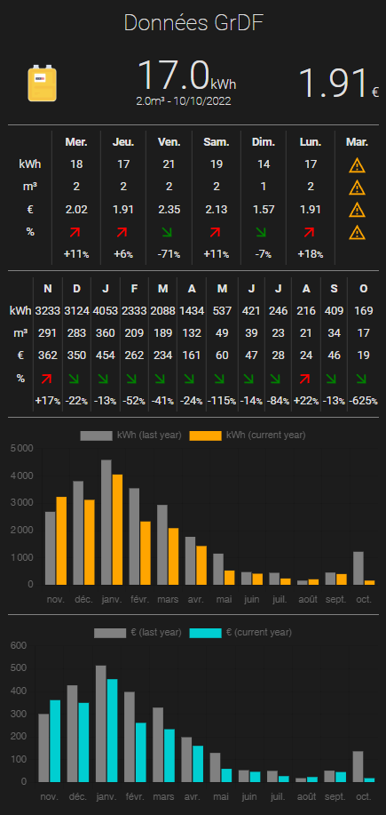
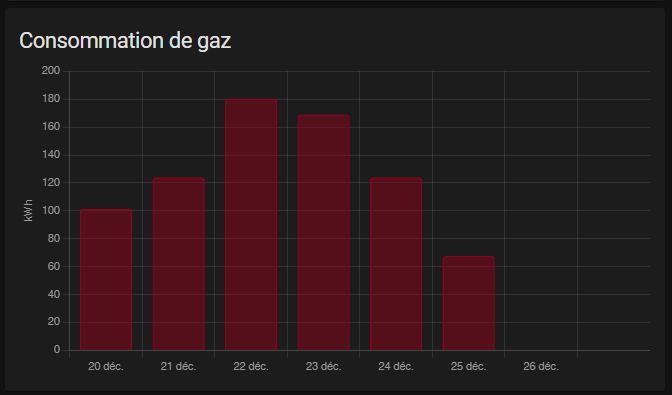

# Home Assistant GrDF Gazpar

[](https://github.com/ssenart/home-assistant-gazpar/releases)
[](https://hacs.xyz/)
[](https://github.com/ssenart/home-assistant-gazpar/actions/workflows/ci.yaml)
[](LICENSE)

A Home Assistant custom integration that brings your GrDF gas consumption into Home Assistant, from your Gazpar meter data.



The integration retrieves the data through the [PyGazpar](https://github.com/ssenart/pygazpar) library and exposes it as the `sensor.gazpar` entity, with daily, weekly, monthly and yearly readings in its attributes. It is compatible with the [Lovelace Gazpar Card](https://github.com/ssenart/lovelace-gazpar-card).

## Contents

- [Features](#features)
- [Requirements](#requirements)
- [Quick start](#quick-start)
- [Installation](#installation)
- [Configuration](#configuration)
- [Sensor attributes](#sensor-attributes)
- [Energy dashboard](#energy-dashboard)
- [Troubleshooting](#troubleshooting)
- [Development](#development)
- [Related projects](#related-projects)

## Features

- Set up from the Home Assistant UI, with the account checked against GrDF before it is saved.
- One sensor per meter (PCE), with a device and a unique ID.
- Daily, weekly, monthly and yearly readings in the sensor attributes, and a cumulative energy state in kWh.
- The last known state is kept when GrDF cannot be reached, so the sensor does not blank out.
- Existing YAML configurations keep working: they are imported into the UI.

## Requirements

- Home Assistant **2026.9.0** or newer.
- A GrDF account (the one you use on [Mon Espace GrDF](https://monespace.grdf.fr)).
- Your meter identifier (PCE), which is shown in your GrDF account.

## Quick start

1. Install the integration with HACS (see [Installation](#installation)) and restart Home Assistant if asked.
2. Go to **Settings > Devices & services > Add integration** and search for **GrDF Gazpar**.
3. Enter your GrDF username and password, your PCE identifier, and a name for the sensor (default: `gazpar`).
4. Check that `sensor.gazpar` appears with a state in kWh. The first download can take a few minutes.

## Installation

### Method 1: HACS (recommended)

1. In [HACS](https://hacs.xyz/), open the upper left menu and select **Custom repositories**.
2. Add `https://github.com/ssenart/home-assistant-gazpar` with the category **Integration**, then click **Add**.
3. Open the new repository, click **Download** and keep the latest version.
4. Restart Home Assistant.

### Method 2: Manual

1. Copy the `custom_components/gazpar` directory into the `custom_components` directory of your Home Assistant configuration.
2. Restart Home Assistant.

## Configuration

### Set up from the Home Assistant UI

Go to **Settings > Devices & services > Add integration**, search for **GrDF Gazpar**, and enter:

- your GrDF username and password,
- your PCE identifier,
- a name for the sensor. The entity is named after it, so `sensor.gazpar` for the default name.

The account is checked against GrDF before it is saved.

Once set up, the update interval and the number of days downloaded can be changed from the integration's **Configure** button.

### YAML configuration (legacy, still supported)

Existing YAML configurations keep working without any change. When Home Assistant starts, the YAML configuration is imported into the UI, and the sensor is then managed by that entry. While the YAML configuration is present, it updates the entry of the same meter, so its values take precedence over the options set in the UI. You can remove the YAML configuration once you are happy with the UI setup; the entry stays.

Add to your `configuration.yaml`:

```yaml
sensor:
  - platform: gazpar
    name: gazpar
    username: "your-grdf-username"
    password: "your-grdf-password"
    pce_identifier: "xxxxxxxxx"
    tmpdir: /tmp
    scan_interval: "04:00:00"
    lastNDays: 365
```

| Option | Default | Description |
|---|---|---|
| `name` | `gazpar` | The sensor name. |
| `username` | required | Your GrDF account username. |
| `password` | required | Your GrDF account password. |
| `pce_identifier` | required | The identifier of your meter (PCE). |
| `tmpdir` | required | The folder where the Excel files from GrDF are stored. It is only used with `datasource: excel`, but it must be set, and the folder must exist before Home Assistant starts. |
| `datasource` | `json` | `json`, `excel`, or `test` (sample data, no connection to GrDF). |
| `scan_interval` | `04:00:00` | How often GrDF is queried. |
| `lastNDays` | `1095` | The number of days of data to download from GrDF (3 years). |

Multiple accounts are declared as separate platform entries:

```yaml
sensor:
  - platform: gazpar
    name: mygazpar
    username: "first-username"
    password: "first-password"
    pce_identifier: "xxxxxxxxx"
    tmpdir: /tmp
    scan_interval: "08:00:00"

  - platform: gazpar
    name: othergazpar
    username: "second-username"
    password: "second-password"
    pce_identifier: "yyyyyyyyy"
    tmpdir: /tmp
    scan_interval: "08:00:00"
```

Restart Home Assistant after editing `configuration.yaml`.

## Sensor attributes

The state of `sensor.gazpar` is the cumulative energy in kWh, computed from the index readings. If the readings do not allow a state to be computed (for example because of a gap in the index data), the sensor keeps its last known state and logs a warning.

The attributes keep the most recent readings: at most 14 daily, 20 weekly, 24 monthly, 5 yearly and 1 hourly. The `username` is not exposed in the attributes.

<details>
<summary>Example of attributes</summary>

```yaml
attribution: Data provided by GrDF
pce: 123456789
unit_of_measurement: kWh
friendly_name: gazpar
icon: mdi:fire
device_class: energy
state_class: total_increasing
errorMessages:
hourly:
daily:
  - time_period: 07/10/2022
    start_index_m3: 15714
    end_index_m3: 15716
    volume_m3: 2
    energy_kwh: 21
    converter_factor_kwh/m3: 11.27
    type: Mesuré
    timestamp: "2022-10-09T20:59:12.356210"
  - time_period: 06/10/2022
    start_index_m3: 15713
    end_index_m3: 15714
    volume_m3: 2
    energy_kwh: 17
    converter_factor_kwh/m3: 11.27
    type: Mesuré
    timestamp: "2022-10-09T20:59:12.356210"
weekly:
  - time_period: Du 03/10/2022 au 09/10/2022
    volume_m3: 9
    energy_kwh: 87
    timestamp: "2022-10-09T20:59:13.391911"
monthly:
  - time_period: "Octobre 2022 "
    volume_m3: 12
    energy_kwh: 119
    timestamp: "2022-10-09T20:59:14.447149"
yearly:
  - time_period: "2022"
    energy_kwh: 11958
    volume_m3: 1078
  - time_period: "2021"
    energy_kwh: 23148
    volume_m3: 2099
```

</details>

## Energy dashboard

### Gazpar2HAWS (recommended)

[Gazpar2HAWS](https://github.com/ssenart/gazpar2haws) feeds the Home Assistant Energy dashboard directly. It rebuilds the full data history and keeps it updated, and it writes to Home Assistant's long-term statistics rather than through a regular sensor state, so it is not affected by the spurious-jump issue described below.

It publishes a statistics-only identifier with no backing entity, by design. Home Assistant will warn "Entity not defined" when you add it as the Energy dashboard's gas source. That warning is expected and safe to ignore. The [Gazpar2HAWS FAQ](https://github.com/ssenart/gazpar2haws/blob/main/docs/FAQ.md#can-i-use-these-entities-in-the-energy-dashboard) explains why and how to make it disappear.

### Legacy method: this integration's sensor

In the Home Assistant Energy configuration panel, set `sensor.gazpar` as the gas consumption source.



I prefer an alias for every sensor, so I keep control of the naming. A template sensor, `gas_energy`, can feed the dashboard in its place. The `gas_volume` template does the same for volume (m³) data instead of energy (kWh). Both are defined under the same `template:` key:

```yaml
template:
  - sensor:
      - name: gas_energy
        unit_of_measurement: "kWh"
        state: "{{ states('sensor.gazpar') }}"
        icon: mdi:fire
        device_class: energy
        state_class: total_increasing
      - name: gas_volume
        unit_of_measurement: "m³"
        state: "{{ state_attr('sensor.gazpar', 'daily')[0]['start_index_m3'] + state_attr('sensor.gazpar', 'daily')[0]['volume_m3'] }}"
        icon: mdi:fire
        device_class: gas
        state_class: total_increasing
```

⚠️ **Known issue, fixed in 1.3.14 ([#86](https://github.com/ssenart/home-assistant-gazpar/pull/86)):** before this version, a corrupted or not-yet-finalized GrDF daily reading could make the sensor's cumulative state jump by thousands to tens of thousands of kWh in one update. Home Assistant's Energy dashboard reads its own long-term statistics, built from the differences between successive sensor states. Upgrading to 1.3.14 or newer prevents *new* jumps, but it does **not** repair statistics that already recorded one.

If the dashboard shows an implausible spike for a month while other sources (the sensor's attributes, or the [Lovelace Gazpar Card](https://github.com/ssenart/lovelace-gazpar-card)) look correct, this is the likely cause. To fix it:

- correct the affected months in **Developer tools > Statistics**, or with the `recorder.adjust_sum_statistics` service, or
- switch to [Gazpar2HAWS](https://github.com/ssenart/gazpar2haws), which rebuilds the full history cleanly.

## Troubleshooting

**`An error occurred while loading data. Status code: 500`**
You are asking for more data than GrDF has. Reduce `lastNDays` (see issue [#62](https://github.com/ssenart/home-assistant-gazpar/issues/62)).

**Login fails with a 401 or "Authentication failed"**
Check that the same username and password work on [Mon Espace GrDF](https://monespace.grdf.fr). Do not use special characters in your password. If the error persists with working credentials, open an issue with the Home Assistant log around the failure.

**The sensor shows `unavailable` or keeps an old state**
Look at the `errorMessages` attribute, then at the Home Assistant log for the `gazpar` integration. A failed query keeps the data of the last successful one, so the state stays on the previous value while the error is reported.

**The YAML setup fails at startup**
Make sure the `tmpdir` folder exists before Home Assistant starts, and that `tmpdir` is set, because it is required in YAML.

**An implausible spike in the Energy dashboard**
See [Known issue](#energy-dashboard) above.

## Development

The project uses [uv](https://docs.astral.sh/uv/) for dependencies and tools, and the versions are locked in `uv.lock`.

```bash
uv sync --locked                      # install the dependencies and the dev group
uv run --locked ruff format --check . # formatting
uv run --locked ruff check .          # lint
uv run --locked mypy .                # type checks
uv run --locked pytest tests          # tests
```

The live GrDF test needs a real account. Set `GRDF_USERNAME`, `GRDF_PASSWORD` and `PCE_IDENTIFIER` in the environment. Without `GRDF_USERNAME`, the test is skipped.

### Releases

Releases are made from the **Create Release** GitHub workflow, started by hand with a version number. It checks the version against the branch, the existing tags and the changelog, then bumps the version files, finalizes `CHANGELOG.md`, tags the commit and creates the GitHub release. The integration is installed from that tag through HACS. Nothing is published to a package index.

Version rules by branch:

| Branch | Version | Example |
|---|---|---|
| `develop` | alpha | `1.4.0a1` |
| `release/X.Y` | beta or release candidate | `1.4.0b1`, `1.4.0rc1` |
| `main` | final | `1.4.0` |

Keep the changes in the `[Unreleased]` section of `CHANGELOG.md`: the workflow uses it as the release notes. Run the workflow as a dry run first, and as a draft release if you want to review it before publishing.

## Related projects

- [Lovelace Gazpar Card](https://github.com/ssenart/lovelace-gazpar-card): a Lovelace card for the Gazpar data.
- [Gazpar2HAWS](https://github.com/ssenart/gazpar2haws): feeds the Energy dashboard, with the full history.
- [Gazpar2MQTT](https://github.com/ssenart/gazpar2mqtt): publishes the data over MQTT. It is a loosely coupled alternative, because this integration relies on the Home Assistant API, which can change between releases.
- [PyGazpar](https://github.com/ssenart/pygazpar): the library that retrieves the data from GrDF.

## License

See [LICENSE](LICENSE).
